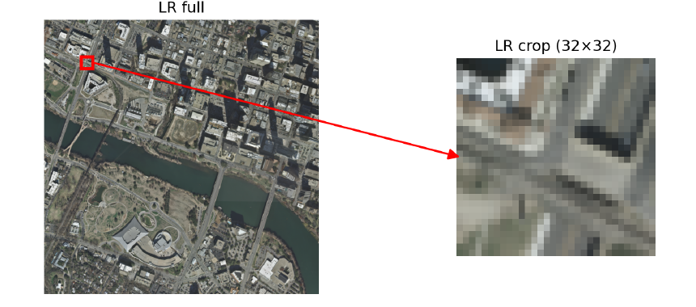
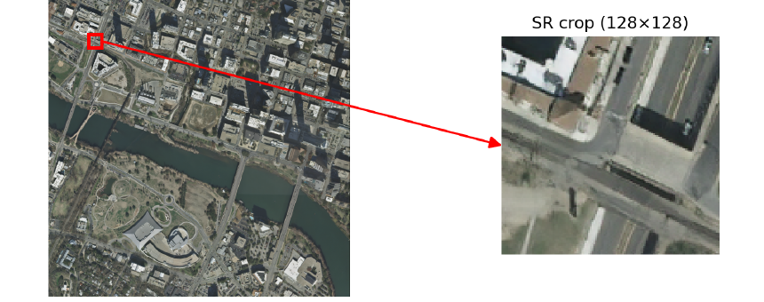
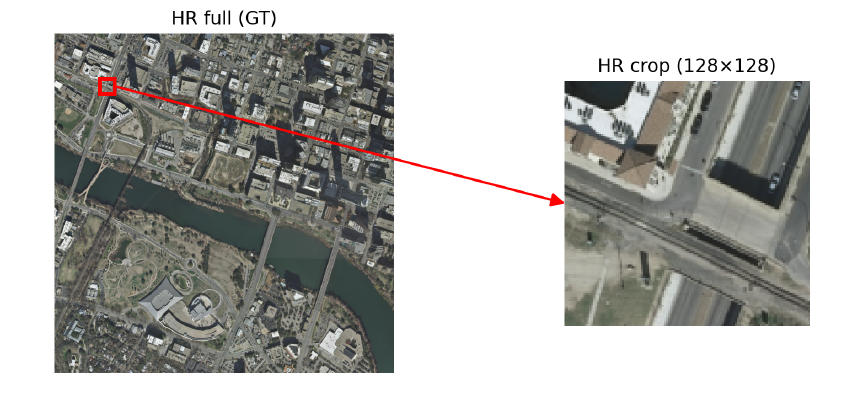
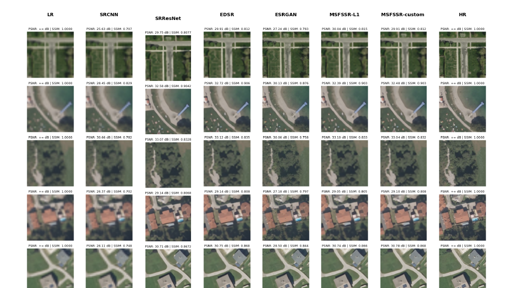

# Satellite Image Super-Resolution with Deep Learning

A comparative study of **4× single-image super-resolution (SISR)** for satellite imagery. The project implements and evaluates five model families, from SRCNN to a custom multi-scale, frequency-separated network, and compares reconstruction fidelity with perceptual realism.

> **Project report:** [`repport.pdf`](repport.pdf) · **Implementation:** Python / PyTorch

## Results at a glance

- Trained and compared **SRCNN, SRResNet, EDSR, ESRGAN, and MSFSSR** (with L1-only and perceptual-loss variants).
- Built a patch-based workflow for paired **32×32 LR → 128×128 HR** training samples at 4× scale.
- Evaluated reconstructions using **PSNR, SSIM, and LPIPS**, alongside visual comparison against high-resolution references.
- In the report's experiments, **EDSR** reached about **28.2 dB validation PSNR** after 100 epochs. **ESRGAN** produced the most perceptually realistic textures in the qualitative comparison; its adversarial stage trades some pixel-level fidelity for perceptual sharpness.
- Tested tiled inference on a roughly **3000×3000** satellite image, merging patch predictions into a full-scene output.

## Visual results

### Full-scene inference: low-resolution input, ESRGAN output, and reference

The panels below are screenshots of the report's inference example. The red box marks the region enlarged at right.

| Low-resolution input | ESRGAN, 4× output | High-resolution reference |
|:--:|:--:|:--:|
|  |  |  |

### Model comparison

Report comparison across the LR input, five model variants, and HR reference. The figure shows representative test examples; it is a visual comparison, not an aggregate benchmark chart.



## Approach

1. **Prepare paired data:** use co-registered low- and high-resolution satellite images. The report describes 360 pairs and non-overlapping patch extraction, with an 80/10/10 train/validation/test split in the project configuration.
2. **Train reconstruction models:** optimize SRCNN, SRResNet, and EDSR for pixel-level reconstruction; train ESRGAN with a pixel-wise pretraining stage followed by perceptual and adversarial training.
3. **Explore a custom architecture:** MSFSSR combines multi-scale feature processing with low- and high-frequency branches. Compare L1-only training with an L1 + perceptual-loss variant.
4. **Evaluate and inspect:** measure PSNR, SSIM, and LPIPS, compare representative outputs, and run tiled inference on a larger satellite scene.

## Repository map

```text
src/
  utils/                    Model architectures, data handling, and training utilities
  models/checkpoints/       Training histories and metric files
notebooks/                  Model training and experiment notebooks
config.yaml                 Dataset, patch, and training configuration
repport.pdf                 Full project report and experiment details
assets/                     README figures extracted from the report
```

## Reproducing the experiments

The repository contains training notebooks, utilities, and experiment histories. The satellite dataset is not included; configure the raw data paths in `config.yaml` before running the preprocessing and training workflow. The configuration expects 4× upscaling, 32×32 LR patches, 128×128 HR patches, and 100 epochs for the common training setup. Use the notebooks under `notebooks/` for the model-specific experiment flows.

Pretrained `.pth` weights and the dataset are not present in this repository snapshot, so inference and full training require those files to be supplied separately. See [`repport.pdf`](repport.pdf) for the detailed methodology, plots, and reported comparisons.

## Tech stack

- Python, PyTorch, torchvision
- NumPy, pandas, Pillow / image processing utilities
- Jupyter notebooks
- Metrics: PSNR, SSIM, LPIPS

## Authors

Adnane Qassiri · Yasser Nadi · Said Jadli

Academic project supervised by Pr. Anass Belcaid.
